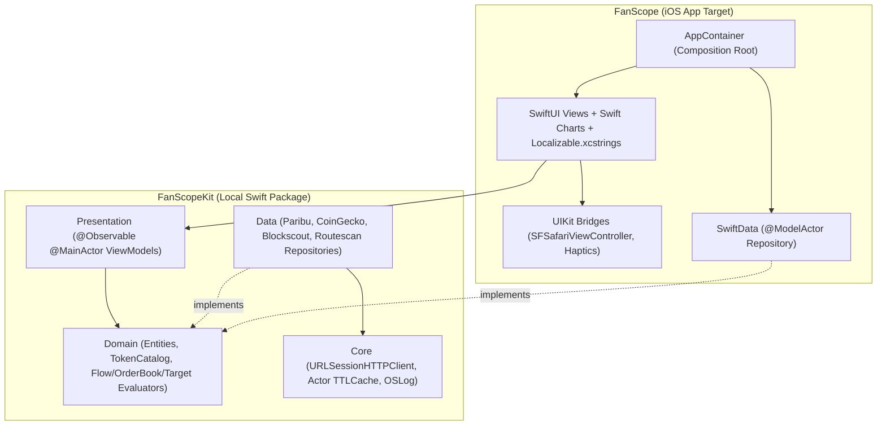

# FanScope

Native iOS application for tracking Turkish fan token TRY markets, live order book depth, circulating/total supply ratios, and on-chain mint, burn, and exchange wallet flows across Ethereum and Chiliz Chain.

Built with **Swift 6**, **SwiftUI**, **UIKit interoperability**, **Swift Charts**, **SwiftData**, and **Swift Testing** — zero third-party SDK dependencies and no API keys required to build and run.

## Features

- **Live TRY Markets (Paribu):** Tracks 18 fan token TRY markets (`FB`, `GAL`, `BJK`, `TRA`, `GOZ`, `CHZ`, `BAR`, `PSG`, `JUV`, `ACM`, `ASR`, `ATM`, `CITY`, `AFC`, `INTER`, `NAP`, `ARG`, `POR`) with 24h volume/top-mover summaries, category filters, sorting, debounced search, 7-day sparklines, and `scenePhase`-aware 15-second live polling.
- **Interactive Charts & Supply Analytics:** Touch-scrubbing 7-day TRY `Swift Charts` (with a 24h price range bar fallback for tokens without CoinGecko sparklines) and merged circulating/total/max supply + holder metrics.
- **On-Chain Flow Explorer:** Classifies real Ethereum (Blockscout v2) and Chiliz Chain (Routescan v2) transfers into `Mint`, `Burn`, `Cold Outflow`, `Exchange Inflow`, and standard transfers, computes 30-day supply/exchange flow summaries, lists top holders, and opens live transaction/contract proofs in-app via `SFSafariViewController`.
- **Live Order Book Depth:** Visualizes Paribu bid/ask walls, spread (`TRY` and `%`), and bid pressure ratio.
- **Offline-First SwiftData Watchlist & Price Targets:** Persists favorite tokens, rise/drop TRY targets, and personal trade notes using a `@ModelActor` SwiftData repository, with reached-target tab badges and opt-in local notifications (`UNUserNotificationCenter`).
- **Live EN / TR Localization:** Full English and Turkish localization via `Localizable.xcstrings` with instant in-app locale switching without restarting.

## Architecture

The project separates platform-independent Core, Domain, Data, and Presentation layers into a local Swift Package (`Packages/FanScopeKit`) consumed by a thin `FanScope` iOS app target. ViewModels import only `Foundation` and `Observation` (no `SwiftUI` or `UIKit` coupling), allowing the entire test suite to execute in milliseconds via `swift test`.



## Public Data Sources & Resilience

| Source | Data | Caching & Resilience |
| :--- | :--- | :--- |
| **Paribu Public API** | Live TRY tickers (`/market/ticker`) and order book depth (`/orderbook`) | 15s / 5s `TTLCache` |
| **CoinGecko Public API** | Circulating/total/max supply and 7-day TRY sparklines | 5m `TTLCache` + stale-cache fallback on HTTP `429` |
| **Ethereum Blockscout v2** | On-chain supply, holders, mint/burn/transfers (`FB`, `BJK`, `CHZ`) + address tags | 60s `TTLCache` + partial-failure isolation |
| **Chiliz Routescan v2** | On-chain supply, top holders, and exchange wallet flows (`GAL`, `TRA`, `BAR`, etc.) | 60s `TTLCache` + partial-failure isolation |

## Engineering Decisions

- **Swift 6 Strict Concurrency:** `SWIFT_STRICT_CONCURRENCY = complete` with zero compiler warnings across both Xcode 16.4 (GitHub Actions CI) and Xcode 27. `actor TTLCache`, `@ModelActor` for SwiftData persistence, `@preconcurrency` + `nonisolated` isolation around `UserNotifications`, and `Synchronization.Mutex` in test stubs.
- **Arbitrary-Precision Token Parsing:** 18-decimal ERC-20/CAP-20 balances exceed `Int64.max`; `TokenAmountParser` scales uint256 string values using `Decimal` exponents and parses 6-digit fractional ISO-8601 timestamps with `Date.ISO8601FormatStyle`.
- **Graceful Degradation:** Upstream CoinGecko `429` rate limits fall back to `TTLCache.staleValue`, individual on-chain sub-requests (`tokenInfo`, `transfers`, `holders`) fail independently, and `WatchlistViewModel` remains usable offline when market fetches fail.
- **Parallel-Safe Unit Testing:** Because Apple `Swift Testing` runs `@Test` functions in parallel by default, `MockURLProtocol` isolates handlers per unique test host behind `Synchronization.Mutex` instead of a shared static closure.
- **No Third-Party Dependencies:** Built purely on Apple frameworks (`URLSession`, `Observation`, `Swift Charts`, `SwiftData`, `SafariServices`, `UserNotifications`, `OSLog`, `Testing`) with `PrivacyInfo.xcprivacy` included.

## Testing & CI

Every pull request runs `.github/workflows/ci.yml` on `macos-15` (running `swift test` and an iOS Simulator `xcodebuild` check).

- **`FanScopeKitTests` (44 tests across 12 suites):**
  - Core: `HTTPClientTests`, `TTLCacheTests`, `FanScopeFormatterTests`
  - Domain: `OnChainFlowClassifierTests`, `OrderBookAnalyzerTests`, `PriceTargetEvaluatorTests`
  - Data: `TokenAmountParserTests`, `DefaultMarketRepositoryTests` (including HTTP `429` stale fallback), `DefaultOnChainRepositoryTests` (Ethereum/Chiliz routing + partial failure)
  - Presentation: `MarketListViewModelTests`, `TokenDetailViewModelTests`, `WatchlistViewModelTests` (including offline fallback)
- **`FanScopeTests`:** `LoadStateTests`, `AppLanguageTests`, and in-memory `ModelContainer` CRUD tests for `SwiftDataWatchlistRepository`.

## Running Locally

### Run `FanScopeKit` Unit Tests
```bash
cd Packages/FanScopeKit
swift test
```

### Build & Run iOS App
1. Open `FanScope.xcodeproj` in Xcode (iOS 18.0+ Simulator or physical iPhone).
2. Select the shared `FanScope` scheme and press `Cmd + R` (or `Cmd + U` for app tests).

Or build from the command line:
```bash
xcodebuild build \
  -project FanScope.xcodeproj \
  -scheme FanScope \
  -sdk iphonesimulator \
  -destination 'generic/platform=iOS Simulator' \
  CODE_SIGNING_ALLOWED=NO
```

## Disclaimer

FanScope is a read-only market and public blockchain analytics tool. It does not execute trades, custody funds, or provide investment advice.
